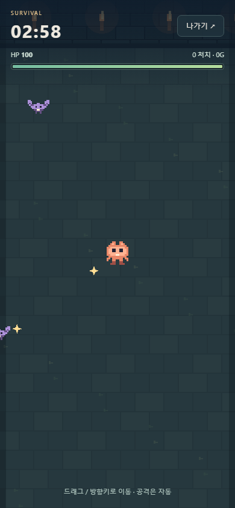
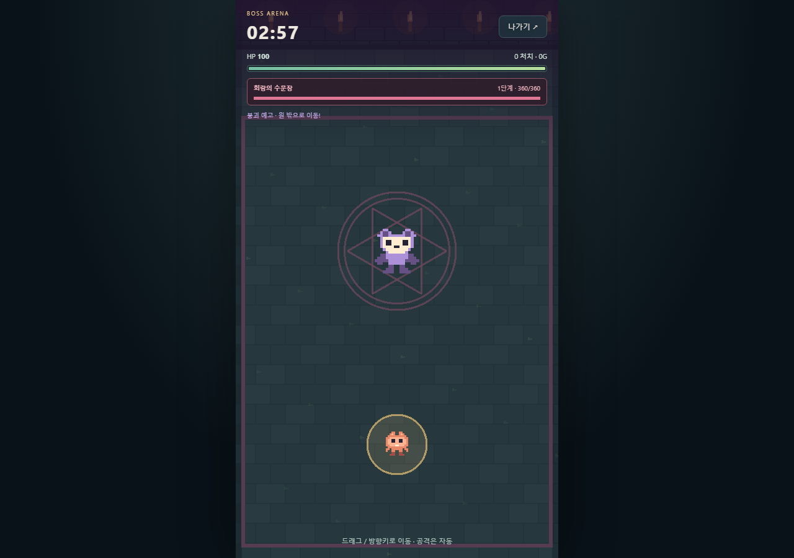
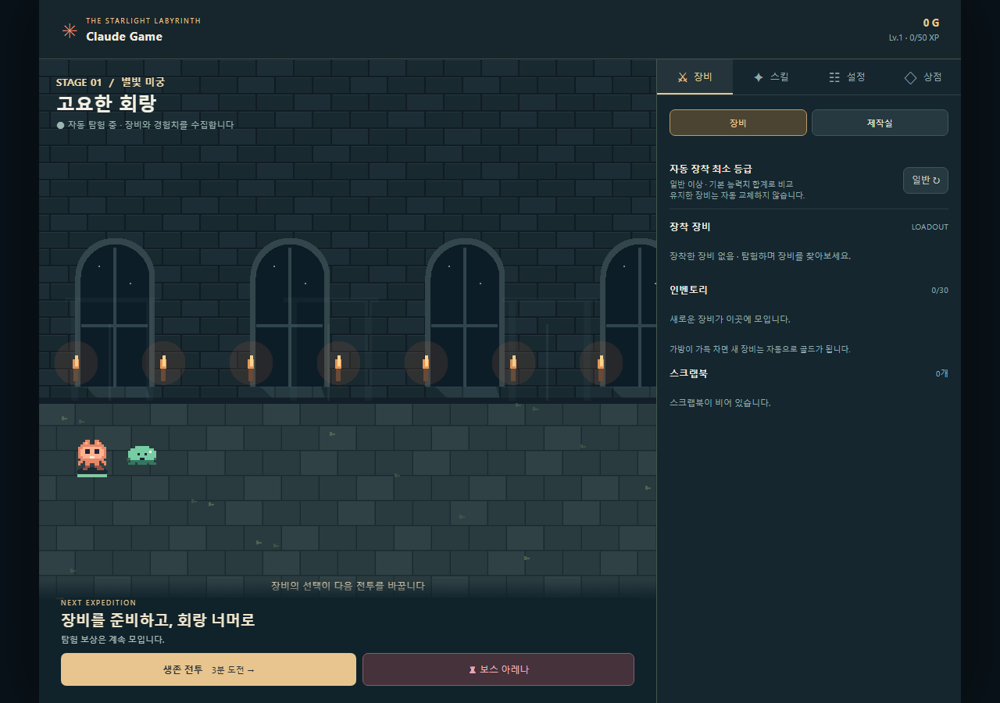
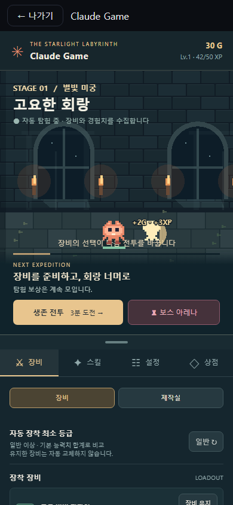

<div align="center">

# ✦ Claude Game
### THE STARLIGHT LABYRINTH

**자동 탐험으로 성장하고, 직접 움직여 생존하는 모바일 친화형 웹 RPG**

[🎮 게임 플레이](https://www.fungood.co.kr/claude_game/) · [📖 설계 문서](docs/) · [🐛 이슈 제보](https://github.com/jflakeee/claude_game/issues)

</div>

[](https://www.fungood.co.kr/claude_game/)
[](https://phaser.io/)
[](https://github.com/jflakeee/claude_game/actions/workflows/p0-safety.yml)
[](https://github.com/jflakeee/claude_game/actions/workflows/p0-browser.yml)

> **개발 상태:** 공개 데모는 `master` 기준입니다. 위 테스트 배지는 별도 안정화 브랜치의 검증 상태를 나타냅니다.

---

## 🎮 게임 소개

**Claude Game**은 별빛 미궁을 탐험하며 장비를 수집하고 캐릭터를 성장시키는 **Phaser 기반 웹 RPG**입니다. 자동 탐험으로 보상을 모으고, 생존 전투와 보스 아레나에서는 직접 캐릭터를 이동시켜 적의 공격을 피합니다.

> **현재 개발 중인 프로젝트입니다.** 기능과 밸런스, 모바일 사용성은 계속 개선되고 있습니다.

## 📸 게임 화면

실제 프로젝트 QA 과정에서 촬영한 화면입니다. 최신 개발 브랜치의 UI와 일부 차이가 있을 수 있습니다.

<table>
  <tr>
    <td align="center"><strong>모바일 탐험</strong></td>
    <td align="center"><strong>보스 전투</strong></td>
  </tr>
  <tr>
    <td></td>
    <td></td>
  </tr>
  <tr>
    <td align="center"><strong>데스크톱 플레이</strong></td>
    <td align="center"><strong>웹 포털</strong></td>
  </tr>
  <tr>
    <td></td>
    <td></td>
  </tr>
</table>

[📷 추가 QA 스크린샷 보기](docs/qa/2026-10-06/deployment/)

## ✨ 주요 기능

| 콘텐츠 | 설명 |
| --- | --- |
| 🗺️ 자동 탐험 | 자동 전투로 스테이지를 진행하고 경험치와 보상을 획득 |
| ⚔️ 생존 전투 | 방향키 또는 드래그로 이동하며 3분간 생존, 공격은 자동 |
| 👑 보스 아레나 | 보스의 패턴과 위험 지역을 파악하며 전투 |
| 🎒 장비와 성장 | 아이템 획득, 장비 관리, 능력치 성장 |
| 🛠️ 제작과 거래 | 재료 수집과 제작, 상점 및 시장 시스템 |
| 💾 저장과 복구 | 브라우저 저장, 중단된 전투 정산 복구, 다중 탭 저장 충돌 방지 |
| 📱 모바일 대응 | 터치 조작, 화면 크기 변화 대응, 움직임 감소·사운드 설정 |

## 🚀 바로 플레이

**[▶ Claude Game 웹 데모 열기](https://www.fungood.co.kr/claude_game/)**

별도의 설치 없이 브라우저에서 실행할 수 있습니다. 모바일과 데스크톱 브라우저를 모두 고려해 개발하고 있습니다.

### 기본 조작

- **자동 탐험:** 대기 화면에서 자동 진행
- **생존 전투:** 화면을 드래그하거나 키보드 방향키로 이동
- **공격:** 전투 중 자동 공격
- **보스 전투:** 대기 화면의 **보스 아레나** 버튼으로 진입

## 🧰 기술 스택

| 영역 | 기술 |
| --- | --- |
| 게임 엔진 | Phaser 3 |
| 언어 | JavaScript (ES Modules) |
| 빌드/개발 서버 | Vite 5 |
| 단위 테스트 | Vitest 2 |
| 브라우저 검증 | Playwright / Chromium |
| 자동화 | GitHub Actions |

## 💻 로컬 실행

Node.js와 npm이 필요합니다.

```bash
git clone https://github.com/jflakeee/claude_game.git
cd claude_game
npm ci
npm run dev
```

개발 서버가 출력하는 주소에서 게임을 확인할 수 있습니다.

```bash
npm test
npm run build
```

위 명령으로 단위 테스트와 프로덕션 빌드를 실행할 수 있습니다.

## 🧪 품질과 개발 현황

이 프로젝트는 저장 안정성, 보상 중복 지급 방지, 재접속 복구 및 모바일 브라우저 동작을 중점적으로 검증합니다.

- **안정성 테스트:** 저장·거래·전투 보상 등 핵심 로직 회귀 검증
- **브라우저 테스트:** 모바일 터치 에뮬레이션, 화면 회전, 다중 탭, 저장 실패와 복구
- **성능 측정:** 모바일 에뮬레이션 환경의 전투 FPS와 프레임 지연 기록

일부 최신 실험적 개선은 `fix/p0-transaction-safety-20261111` 작업 브랜치에서 검증 중이며 **기본 브랜치 또는 공개 데모에 아직 반영되지 않았을 수 있습니다.** 실제 기기 성능과 브라우저 에뮬레이션 측정 결과는 구분해 관리합니다.

## 📂 프로젝트 구조

```text
src/
  scenes/       # 자동 탐험·전투 화면
  systems/      # 전투, 장비, 제작, 거래 등 게임 로직
  state/        # 상태 관리·저장·복구
  ui/           # 인터페이스
  data/         # 게임 데이터
tests/          # 단위·브라우저·시각 검증
docs/           # 설계 및 검증 기록
.claude/        # 개발 에이전트 설정과 스킬
```

## ❓ 자주 묻는 질문

**휴대전화에서도 플레이할 수 있나요?**  
모바일 브라우저와 터치 조작을 지원하도록 개발 중입니다. 기기·브라우저에 따라 성능 차이가 있을 수 있습니다.

**캐릭터를 직접 조작해야 하나요?**  
기본 탐험은 자동 진행됩니다. 생존 전투와 보스 아레나에서는 직접 이동해 공격을 피하며 공격은 자동으로 처리됩니다.

**저장 데이터는 어디에 보관되나요?**  
현재 게임은 브라우저 로컬 저장소를 사용합니다. 다른 기기나 브라우저로 자동 동기화되지 않으며, 사이트 데이터 삭제 시 저장 기록을 잃을 수 있으니 주의해 주세요.

**개발 중인 기능을 어디서 볼 수 있나요?**  
실험적 변경 사항은 [안정화 작업 브랜치](https://github.com/jflakeee/claude_game/tree/fix/p0-transaction-safety-20261111)에서 확인할 수 있습니다. 공개 데모와 기능이 다를 수 있습니다.

## 🤝 참여 및 피드백

버그, 모바일 조작 문제, 밸런스 개선 아이디어는 [GitHub Issues](https://github.com/jflakeee/claude_game/issues)에 남겨 주세요. 재현 환경(기기·브라우저)과 발생 순서를 함께 적어 주시면 도움이 됩니다.

---

<div align="center">

**Explore · Survive · Grow**

[게임 플레이](https://www.fungood.co.kr/claude_game/) · [소스 코드](https://github.com/jflakeee/claude_game)

</div>
